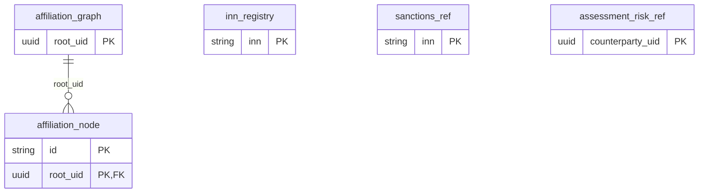

# Логическая модель данных — схема `affiliation`

Выдержка из `Модель_данных/10_Логическая_модель.md` (репозиторий pmrk-design): ER-диаграмма схемы и описание таблиц.

## ER-диаграмма

## Таблицы

#### `affiliation.affiliation_graph` — Граф аффилированности

Вид: Read-модель внешнего источника. БО: 21.1.AGG. Источник: СПАРК. Ключ: `root_uid`.

| Атрибут | Тип | Обяз. | Ключ | Описание |
|---|---|---|---|---|
| `root_uid` | UUID | + | PK | Идентификатор корневого контрагента. Совпадает с `{uid}` пути. Клик по корневому узлу — переход на «Общие сведения» |
| `root_name` | Строка | + |  | Наименование корневого контрагента |
| `root_inn` | Строка | + |  | ИНН корневого контрагента |
| `source_updated_at` | Дата | − |  | Актуальность данных в источнике |
| `loaded_at` | Дата-время | + |  | Загружено в ПМРК |

#### `affiliation.affiliation_node` — Узел связи

Вид: Read-модель внешнего источника. БО: 21.2.SIMPLE. Источник: СПАРК. Ключ: `root_uid`, `id`.

inRegistry/counterpartyUid вычисляются по inn_registry, underSanctions — по sanctions_ref при чтении.

| Атрибут | Тип | Обяз. | Ключ | Описание |
|---|---|---|---|---|
| `id` | Строка | + | PK | Идентификатор узла в графе. Уникален в пределах графа. Стабильный ключ лица: `spark:{SparkID}`, иначе `inn:{ИНН}`, иначе `name:P:{хэш}` / … |
| `name` | Строка | + |  | Наименование ЮЛ или ФИО |
| `inn` | Строка | − |  | ИНН. У ФЛ и иностранных лиц может отсутствовать — «—» |
| `is_person` | Логическое | + |  | Признак физического лица. ЮЛ — голубоватая заливка, ФЛ — зеленоватая; легенда совпадает с диаграммой |
| `kinds` | JSON (массив) | + |  | Типы аффилированности. Уникальные идентификаторы из справочника ниже; у отдельного бенефициара без иных ролей допускается пустой массив. … |
| `level` | Целое | + |  | Уровень в цепочке владения. 1 — непосредственная связь, 2 и далее — по цепочке |
| `direct_share` | Число | − |  | Доля прямого владения, %. Доля показывается текстом; заливка определяется типом лица. Взаимоисключается с `indirectShare`. У совладельцев — … |
| `indirect_share` | Число | − |  | Доля косвенного владения по цепочке, %. Косвенная доля показывается текстом; заливка определяется типом лица |
| `direct_share_rub` | Число | − |  | Доля прямого владения, руб. `Coowner/SharePartRUR` у совладельцев, `SharePartRUR` из `GetCompanyStructure` у дочерних обществ; колонка … |
| `coowner_type` | Перечисление CoownerType | − |  | Тип совладельца. `Coowner/CoownerType`: `RU_LEGAL` — российское ЮЛ (0), `FOREIGN_LEGAL` — иностранное ЮЛ (1), `PERSON` — ФЛ (2). Только у … |
| `manager` | Строка | − |  | Руководитель компании-совладельца. `Coowner/Manager` — ФИО руководителя этой компании; колонка «Руководитель компании» структуры … |
| `parent_ids` | JSON (массив) | − |  | Компании, которыми узел владеет напрямую. `id` узлов, которые этот совладелец держит напрямую, — родитель в дереве владения, ближе к корню: … |
| `not_final_reason` | Строка | − |  | Причина ненахождения конечного бенефициара. `Beneficiary/NotFinalReason/@Name`. Только в `beneficiaries[]` при `IsFinal = false`; колонка … |
| `is_director` | Логическое | + |  | Руководитель (единоличный исполнительный орган). Фиолетовая метка на диаграмме и в таблице. `true`, если в `kinds` есть тип 3 «Руководитель … |
| `root_uid` | UUID | + | PK, FK → affiliation_graph | Корневой контрагент |
| `is_final_beneficiary` | Логическое | + |  | Признак IsFinal источника; включение в beneficiaries |

#### `affiliation.inn_registry` — ИНН контрагентов ПМРК

Вид: Служебная. Ключ: `inn`.

| Атрибут | Тип | Обяз. | Ключ | Описание |
|---|---|---|---|---|
| `inn` | Строка | + | PK |  |
| `counterparty_uid` | UUID | + |  |  |

#### `affiliation.sanctions_ref` — ИНН лиц под санкциями (проекция X-Compliance)

Вид: Служебная. Ключ: `inn`.

Из pmrk.integration.xcompliance.registry.updated: FULL заменяет проекцию, DELTA применяет изменения. Отсутствие ИНН — лицо не под санкциями.

| Атрибут | Тип | Обяз. | Ключ | Описание |
|---|---|---|---|---|
| `inn` | Строка | + | PK | ИНН ЮЛ или ФЛ |
| `subject_type` | Перечисление | + |  | COMPANY / PERSON |
| `source_date` | Дата | + |  | Дата массива или суток изменений X-Compliance |

#### `affiliation.assessment_risk_ref` — Последняя оценка связанного контрагента

Вид: Материализованная проекция. Источник: scoring.assessment.completed. Ключ: `counterparty_uid`.

Обогащение БО 21.2 при чтении; устаревшее событие не заменяет более новый результат..

| Атрибут | Тип | Обяз. | Ключ | Описание |
|---|---|---|---|---|
| `counterparty_uid` | UUID | + | PK | Контрагент |
| `credit_group` | Целое | + |  | Группа 1–4 |
| `score` | Число | + |  | Балл той же оценки |
| `calculated_at` | Дата-время | + |  | Порядок результатов |
| `result_id` | UUID | + |  | Сохранённый результат |

